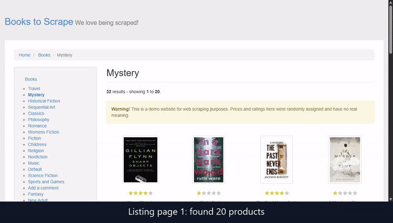
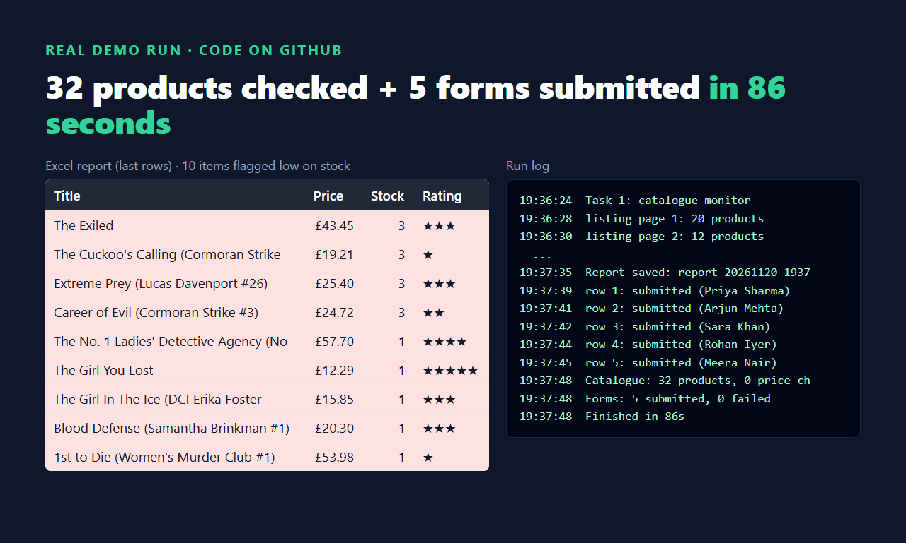

# Browser Automation Demo (Python + Selenium)

Two everyday jobs that people do by hand in a browser, automated end to end:

1. **Catalogue monitor:** opens every listing page of a product category, visits each product, and collects price, stock and rating. It saves a formatted Excel report with a summary sheet and chart, flags low stock, and tracks price changes since the last run.
2. **Bulk form entry:** reads rows from an Excel sheet and submits a web form once per row. It writes `Submitted` or the exact error back into the sheet after each row, so an interrupted run can simply be restarted.



A full run checks 32 products and submits 5 forms in about 90 seconds:



## Run it

```bash
pip install -r requirements.txt
python run.py all            # both tasks, headless
python run.py all --show     # watch the browser work
python run.py all --record   # also save a captioned MP4 + GIF of the run
python run.py catalog --limit 10
python run.py forms
```

Output goes to `output/`: the Excel report, a run log, and the optional video. Chrome must be installed; Selenium downloads the matching driver automatically.

Optional Telegram summary at the end of each run: set `TELEGRAM_BOT_TOKEN` and `TELEGRAM_CHAT_ID` as environment variables.

## What's inside

| File | What it does |
|---|---|
| `run.py` | Command line entry point and run summary |
| `webbot/catalog.py` | Pagination, product pages, retries, polite delays |
| `webbot/report.py` | Excel report: formatting, colour scale, filters, summary + chart, change tracking |
| `webbot/forms.py` | Spreadsheet-driven form filling: text, password, dropdown, checkbox, radio, date |
| `webbot/browser.py` | Chrome setup and the step recorder that builds the video |
| `webbot/notify.py` | Optional Telegram message |

## Built to be adapted

The site-specific parts are kept in one place (the `SELECTORS` map and the `fill_one` function), so pointing this at a different website usually means changing those and nothing else. The same structure handles:

- Entering spreadsheet rows into a CRM, ERP or government portal
- Downloading daily reports or invoices from a dashboard
- Watching prices, stock or new listings, with alerts
- Copying data from one web app into another

## Responsible use

The demo targets two sites built for automation practice: [books.toscrape.com](https://books.toscrape.com) and Selenium's own [web form](https://www.selenium.dev/selenium/web/web-form.html). Real projects should automate only what the target site's terms allow, keep request rates low, and never bypass CAPTCHAs or other bot checks.

## Need something like this?

I build custom automation like this to order: browser bots, data extraction to Excel or Google Sheets, scheduled jobs and Telegram alerts. Get in touch through my Fiverr profile.
